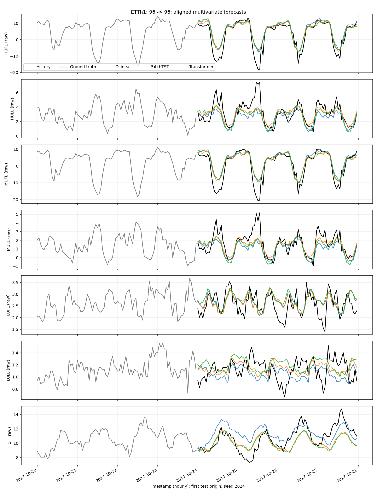
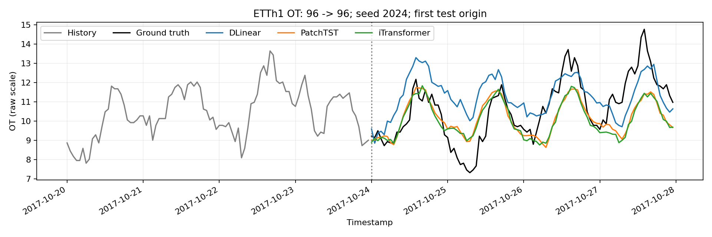
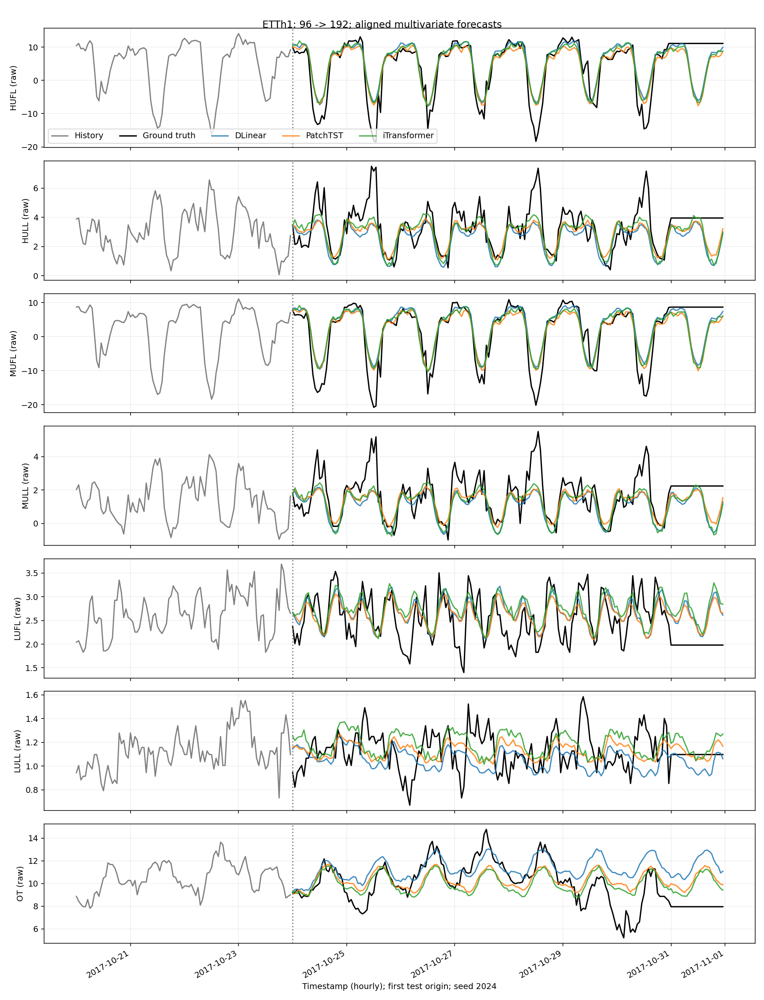
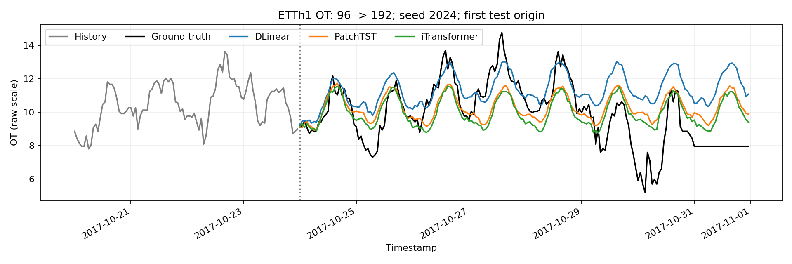
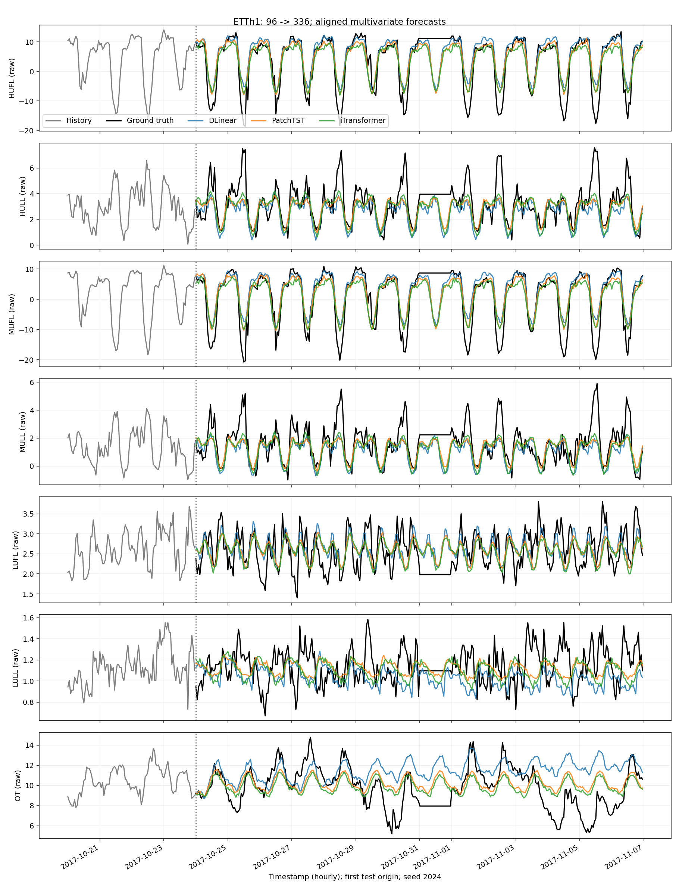
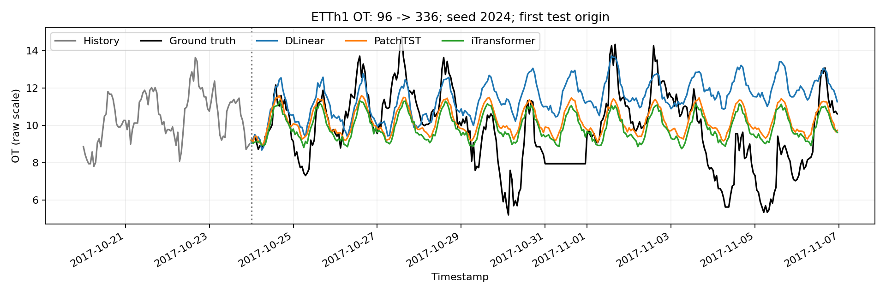
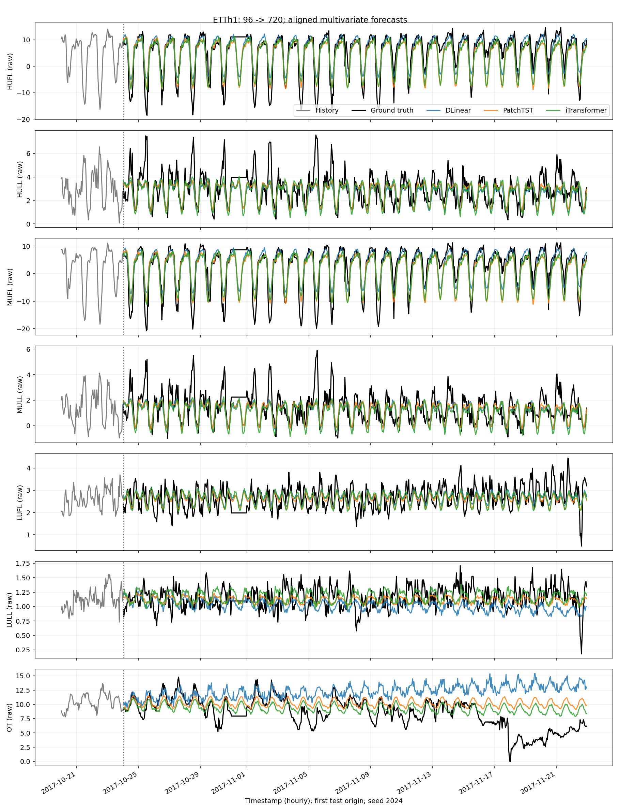
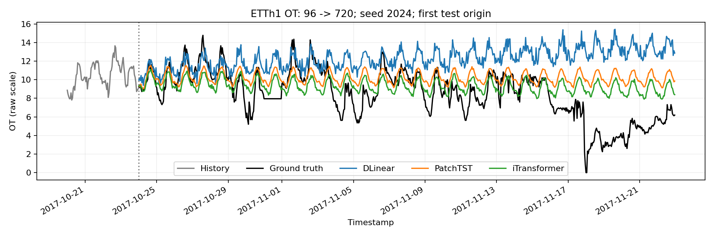
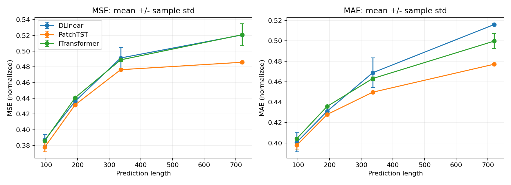

# ETTh1 三模型可复现实验报告

## 1. 实验目的

在固定输入96小时、多变量输入/输出、统一数据划分与指标的条件下，比较DLinear、PatchTST、iTransformer。正式结果与1 epoch Smoke Test严格分开。当前完成 Smoke Test 3/3，正式实验 36/36。

## 2. 核心架构区别

### 三种模型的原理与结果解读边界

本文提供可用于 `REPORT.md` 的学习素材，不包含任何尚未运行的实验指标。架构说明以本项目固定 commit 的 TFB 源码为准；论文结论、代码事实和待验证解释分别标注。实际结果应从 `results/metrics.csv` 与 `results/summary.csv` 引入。

#### 1. 三个模型面对的是同一个预测问题

对一个预测起点，输入是过去 L=96 小时、C=7 个变量的矩阵 `X ∈ R^(L×C)`，目标是未来 H 小时同样 7 个变量的 `Y ∈ R^(H×C)`。一个 batch 的形状为 `[B,96,7] -> [B,H,7]`。模型看到的信息截止于预测起点以前；训练时真实 Y 只用于计算损失。

三者都是直接输出全部 H 步的模型。对于本实验 H=96/192/336/720，每个长度都有自己的训练任务、输出层和 checkpoint，没有把 H=96 模型的输出拼接成其他长度结果。

| 设计问题 | DLinear | PatchTST | iTransformer |
|---|---|---|---|
| 如何表达时间历史 | 移动平均分解后，直接线性映射整个历史 | 每个变量切成短时间片，每片成为 token | 每个变量的整段历史成为 token |
| 注意力主要发生在哪里 | 无注意力 | 同一变量的不同时间片之间 | 不同变量之间 |
| 是否直接混合观测变量 | 默认共享线性层，但前向不混合变量 | 不混合，变量独立前向、共享权重 | 通过变量 token 注意力混合 |
| 输出方式 | 趋势和剩余项预测相加 | 展平该变量的所有 patch 表征，再投影到 H | 每个变量 token 投影到 H |
| 输入窗口归一化 | 无额外窗口归一化 | 有，并在输出还原 | 有，并在输出还原 |

上表的“共享权重”不等于“混合变量”：共享是各变量使用同一套参数；混合是一个变量的本次预测会直接读取其他变量的本次输入。

#### 2. DLinear：以简单结构建立强基线

**代码事实。** 对变量 c 的历史向量 `x_c ∈ R^L`，先用固定移动平均得到趋势 `t_c = MA(x_c)`，剩余项 `s_c = x_c - t_c`，再计算：

```text
y_hat_c = W_trend t_c + b_trend + W_seasonal s_c + b_seasonal
W_trend, W_seasonal ∈ R^(H×L)
```

本项目 TFB 默认移动平均窗口为 25，`individual=False`，即 7 个变量共享两套线性投影。模型的可训练参数量公式为 `2H(L+1)`，与变量数无关；d_model/d_ff 不控制这个模型。固定均值滤波、剩余项和线性投影组合起来仍是输入的仿射函数，所谓“季节项”是分解模块的命名，不意味着网络已显式识别某个周期。移动平均只对已输入的历史窗口操作，边界补齐也不读取预测区间真实值。证据：`vendor/TFB/ts_benchmark/baselines/time_series_library/models/DLinear.py:27–54,64–90` 和 `layers/Autoformer_EncDec.py`。

**论文发现。** DLinear 所在论文在其测试的数据集和当时的 Transformer 基线上发现简单线性预测器具有很强竞争力，强调必须认真比较简单基线。这是特定实验范围内的发现，不能转述为“Transformer 不适合所有时间序列”或“DLinear 一定优于后来的 PatchTST/iTransformer”。[DLinear 论文](https://arxiv.org/abs/2205.13504)

**为什么有竞争力：待本实验检验的解释。** 如果主要可预测成分是稳定的日周期、缓慢趋势和近似线性滞后关系，线性层已经能为不同历史位置学习不同权重。较少的参数和共享权重可能降低有限训练数据上的估计方差，优化也较简单。复杂模型拥有更强表达能力，但不保证在同一数据量与训练预算下泛化更好。这些是与模型结构一致的机制解释；仅凭一次 MSE 排名不能证明哪种机制实际造成了差异。

#### 3. PatchTST：让时间片成为 token

**代码事实。** 一个变量的历史先做窗口内标准化，然后以 patch length=16、stride=8 切片。TFB 会在右侧复制最后一个历史值补 8 个位置。因此 L=96 时 patch 数为：

```text
P = floor((L - patch_len) / stride) + 2 = 12
[B,96,7] -> [B,7,96] -> [B*7,12,16] -> [B*7,12,d_model]
```

每个 patch 经共享线性映射和位置编码成为一个 token。注意力连接同一变量的不同 patch；最终将该变量的 patch 表征展平，通过线性层一次预测 H 步。这里的 12 是当前窗口设置的推导值，论文标题中的“64 Words”不是固定要求每个实验必须产生 64 个 tokens。证据：TFB `models/PatchTST.py:39–45,73–85,95–123` 与 `layers/Embed.py:181–206`。

**论文提出的设计。** Patching 将局部子序列作为建模单位，缩短注意力序列；Channel Independence 让每个变量独立参与前向，且共享 embedding 和 Transformer 权重。论文还研究了自监督预训练，但本项目使用监督训练，不把预训练结论当成本项目的训练方法。[PatchTST 论文](https://arxiv.org/abs/2211.14730)

**直觉与限制。** 时间片保留了局部形状，如上升、下降和峰值附近变化。注意力矩阵从逐时间点的 L×L 变成每变量的 P×P，因而更便于使用较长历史；这只比较注意力部分，不能忽略变量数、网络宽度、前馈层和显卡实现，就断言其实际速度一定最快。变量独立可减少不稳定跨变量关系带来的干扰，并利用共享参数训练；另一方面，也不会直接使用某个变量对另一个变量的同期信息。这是架构取舍，不是对 ETTh1 结果的预判。

#### 4. iTransformer：让变量成为 token

**论文提出的设计。** iTransformer 将注意力轴从时间点改到变量；每个变量的一整段历史先映射为一个 token，再由注意力学习变量间依赖，前馈网络对各 token 做非线性变换。[iTransformer 论文](https://arxiv.org/abs/2310.06625)

**代码事实。** 忽略 batch 维度，核心计算可以写成：

```text
z_c = Embedding(x_c),       x_c ∈ R^L, z_c ∈ R^d
Z' = TransformerEncoder([z_1, ..., z_C, calendar_tokens])
y_hat_c = Projection(Z'_c), y_hat_c ∈ R^H
```

每个 token 包含这个变量的全部 96 步历史，不是某一个时刻的 7 维横截面。固定的时间坐标通过 `Linear(L,d_model)` 的不同输入权重进入表征；变量注意力不会让模型忽略历史的先后位置。输出投影对变量共享，但每个变量的 token 已经吸收其他变量的上下文。证据：TFB `models/iTransformer.py:22–57,69–85`。

**本次 TFB 的细节。** 适配器会传入时间 marks；小时级 `timefeatures.py:106` 生成 HourOfDay、DayOfWeek、DayOfMonth、DayOfYear 四个特征。`DataEmbedding_inverted` 把它们作为额外 tokens 接在 7 个数值变量后，因此本实验默认注意力序列包含 7+4 个 tokens，最后只输出前 7 个数值目标。它们来自历史时间戳的已知日历属性，不含未来观测值。PatchTST/DLinear 忽略这些 marks；这一实现差异须在报告中披露，而不能把三个模型说成具有完全相同的内部特征处理。证据：TFB `layers/Embed.py:143–155`、`models/iTransformer.py:82`、`adapters_for_transformers.py:81–89`。

**直觉与限制。** 若变量间的关系稳定而且能帮助预测，变量注意力可能带来收益；若关系弱、时变或受噪声影响，收益可能不明显。ETTh1 只有 7 个数值变量，不能用一个数据集的结果证明变量注意力在高维数据上的普遍表现，也不能把注意力权重解释为已识别的因果效应。

#### 5. 为什么统一输入 96 不等于复刻论文最佳成绩

TFB 当前 ETTh1 推荐脚本对多个模型/预测长度使用 336 或 512 步历史，本项目按用户要求固定 96 步。统一历史长度有助于比较相同可观测窗口下的行为，但问题变成了“在 96 步约束下哪个实现更合适”，而不是“复现各论文最佳配置”。本项目保留各模型有来源的结构参数，不为了表面一致强迫 DLinear 和 Transformer 具有相同隐藏层参数。详细脚本审计见 `docs/tfb_audit.md`。

96 个小时只覆盖 4 天；较长预测任务可能需要更长历史来估计周期或低频结构。固定 96 会限制所有模型可见信息，其中 PatchTST 原本适于高效使用较长上下文的设计优势未被全面检验。这里的判断来自任务长度和架构，不是对尚未观察结果的解释性结论。

另外，TFB 中的 Time Series Library 版本不是三个原作者仓库的逐文件原样副本。我们报告的是固定 TFB commit、明确配置、统一协议下的复现实验，不将实现差异或训练配置差异伪装成论文结果的精确重现。[TFB 官方仓库](https://github.com/decisionintelligence/TFB)

#### 6. 正确解读预测长度和误差曲线

主表应分别报告每个 H 下三种子的均值和样本标准差。标准差衡量本次随机初始化、训练采样等随机因素导致的运行波动；3 次运行不足以证明普遍统计显著性，也没有覆盖其他数据集、硬件或训练预算的不确定性。

跨长度比较需要检查：

1. 每个 H 都独立训练，并各自由验证集选择 checkpoint。长 H 不是在短 H checkpoint 上追加未来输出。
2. 相同 H 下三个模型必须具有完全相同的测试窗口；不同 H 下可用测试起点数量不同。H 越长，末端能容纳完整未来区间的起点越少，因此 MSE 随 H 的变化不只是“同一批样本预测得更远”的效果。
3. MSE 和 MAE 在同一训练 scaler 尺度下计算。MSE 对较大偏差更敏感，二者排序不同可能提示误差分布不同；若要证明是极端误差造成，需另查分位数或样本级误差。
4. 曲线必须固定同一测试起点、同一 OT 变量、同一 seed 和时间轴。单条 OT 曲线用于理解形状，不能代表全部 7 个变量与全部滑动窗口的总指标。
5. 对长预测区间，更平滑的曲线不必然是程序错误。MSE 下的点预测可能趋向可预测成分，尚未建模的未来波动不能被准确逐点恢复。是否存在欠拟合、均值回归或分布变化，需结合训练/验证曲线、误差随步长变化与消融检验，不能仅凭外观断言。

报告中建议明确使用三种句式：**“本次观察到……”**只引用实际指标和图；**“原论文报告……”**附原论文链接并说明范围；**“一种可能解释是……”**列出尚需验证的机制与可实施检验。如果某个长度尚未完成实验，就只记录未完成原因和运行入口，不推测其排名。

#### 7. 适合继续学习的验证实验

完成当前基线后，可在训练/验证集上开展预先定义的消融：改变输入长度、PatchTST patch/stride、iTransformer 是否使用日历 tokens、DLinear shared/individual，以及固定训练预算下的参数量比较。每次只改变少数可解释因素；测试集保留作最终评估。跨数据集重做协议比在单个 ETTh1 测试结果上反复挑超参数更能检验结论是否稳定。

官方资料入口：[DLinear 作者实现](https://github.com/cure-lab/LTSF-Linear)、[PatchTST 作者实现](https://github.com/yuqinie98/PatchTST)、[iTransformer 作者实现](https://github.com/thuml/iTransformer)。本项目运行权威版本仍是 `vendor/TFB` 的已固定 commit。

## 3. 数据集介绍

ETTh1为小时级电力变压器数据，7变量：HUFL/HULL/MUFL/MULL/LUFL/LULL/OT。原始CSV17420行，本Benchmark依照TFB论文Table5使用前14400行；其余3020行不参与。来源与SHA256见[data/manifest.json](data/manifest.json)，划分证据见[数据协议](docs/data_protocol.md)。

## 4. 训练与评测协议

训练[0,8640)、验证[8640,11520)、测试[11520,14400)。输入96，预测96/192/336/720，Features=M，全7变量预测。验证和测试窗口可使用边界以前的已观测历史，目标完全位于对应集合。测试滑动步长1，窗口数依次2785/2689/2545/2161，保留末批。

StandardScaler仅拟合训练8640行。指标为TFB mse_norm/mae_norm，按所有窗口、预测步、变量等权平均，且与独立向量计算相互验证。测试指标在训练标准化尺度计算；预测曲线显示原始单位OT，不能用单条曲线代表全7变量误差。

每个模型/长度/种子独立训练。正式采用TFB默认最多10 epochs、patience=3、Adam、MSE损失与type1学习率衰减；最小验证MSE选择checkpoint，重新从磁盘加载后才测试。不做测试集选参。三个种子2024/2025/2026，标准差ddof=1。训练按官方多变量loader使用drop_last=True；验证和测试均False。确定性采用TFB full模式（含禁用cuDNN），另强制确定性算法，禁用AMP/TF32；这些设置会影响运行速度，耗时仅用于本机相同协议内比较。完整超参数见[benchmark.json](configs/benchmark.json)和results/configs/。

外层子类修正验证末批权重并固定验证顺序，添加日志、检查和磁盘checkpoint；复用官方模型、训练循环、早停和滚动推理。vendor保持原样。跳过TFB初始化时无关模型的批量导入；未安装未用的Darts/Merlion/Ray等依赖。详见[审计](docs/tfb_audit.md)。

### 采用的主要超参数

| Model | H | Batch | LR | d_model | d_ff | Layers | Heads | Patch/Stride |
| --- | --- | --- | --- | --- | --- | --- | --- | --- |
| DLinear | 96 | 32 | 0.005000 | — | — | — | — | — |
| DLinear | 192 | 64 | 0.001000 | — | — | — | — | — |
| DLinear | 336 | 32 | 0.005000 | — | — | — | — | — |
| DLinear | 720 | 64 | 0.000100 | — | — | — | — | — |
| PatchTST | 96 | 32 | 0.000100 | 512 | 2048 | 1 | 8 | 16/8 |
| PatchTST | 192 | 32 | 0.000100 | 128 | 512 | 2 | 8 | 16/8 |
| PatchTST | 336 | 64 | 0.000100 | 128 | 512 | 2 | 8 | 16/8 |
| PatchTST | 720 | 64 | 0.000100 | 128 | 512 | 2 | 8 | 16/8 |
| iTransformer | 96 | 32 | 0.000100 | 256 | 256 | 2 | 8 | — |
| iTransformer | 192 | 32 | 0.000100 | 256 | 256 | 2 | 8 | — |
| iTransformer | 336 | 32 | 0.000100 | 128 | 128 | 2 | 8 | — |
| iTransformer | 720 | 32 | 0.000100 | 512 | 512 | 2 | 8 | — |

DLinear共享季节/趋势线性层，moving_avg=25；三模型dropout=0.1（DLinear预测分支未使用dropout）。

## 5. 实验环境

```json
{
  "captured_at_Asia_Shanghai": "2026-10-13T10:29:51.935738+08:00",
  "python": "3.8.20 (default, Oct  3 2024, 15:19:54) [MSC v.1929 64 bit (AMD64)]",
  "executable": "E:\\conda_envs\\tsfx\\python.exe",
  "platform": "Windows-10-10.0.26200-SP0",
  "processor": "AMD64 Family 25 Model 80 Stepping 0, AuthenticAMD",
  "logical_cpu_count": 12,
  "torch": "2.4.1+cu121",
  "cuda_runtime": "12.1",
  "user_site_enabled": false,
  "cuda_available": true,
  "tfb_commit": "889459188ec89c9cb3c7e5ec40f30b8c0c5c2529",
  "tfb_worktree_status": "",
  "gpu": "NVIDIA GeForce RTX 3050 Laptop GPU",
  "gpu_memory_bytes": 4294443008,
  "compute_capability": [
    8,
    6
  ],
  "module_provenance": {
    "numpy": {
      "version": "1.24.4",
      "file": "E:\\conda_envs\\tsfx\\lib\\site-packages\\numpy\\__init__.py"
    },
    "pandas": {
      "version": "1.5.3",
      "file": "E:\\conda_envs\\tsfx\\lib\\site-packages\\pandas\\__init__.py"
    },
    "scipy": {
      "version": "1.10.1",
      "file": "E:\\conda_envs\\tsfx\\lib\\site-packages\\scipy\\__init__.py"
    },
    "sklearn": {
      "version": "1.3.2",
      "file": "E:\\conda_envs\\tsfx\\lib\\site-packages\\sklearn\\__init__.py"
    },
    "matplotlib": {
      "version": "3.7.5",
      "file": "E:\\conda_envs\\tsfx\\lib\\site-packages\\matplotlib\\__init__.py"
    },
    "PIL": {
      "version": "10.4.0",
      "file": "E:\\conda_envs\\tsfx\\lib\\site-packages\\PIL\\__init__.py"
    },
    "torch": {
      "version": "2.4.1+cu121",
      "file": "E:\\conda_envs\\tsfx\\lib\\site-packages\\torch\\__init__.py"
    }
  }
}
```

独立conda环境E:\conda_envs\tsfx；完整版本、GPU信息与pip检查见[environment.txt](results/environment.txt)，精确依赖见[requirements-lock.txt](results/requirements-lock.txt)。固定TFB commit记录在环境及每个运行结果中。

交付环境通过PYTHONNOUSERSITE=1完全排除用户site。收尾时将原先从用户site读取的同版本NumPy/绘图库装入tsfx；训练用NumPy的502个源文件/二进制逐个哈希完全一致，记录见[隔离核验](results/archive/numpy_isolation_check.json)。未改变模型、数据或超参数。

## 6. 实验结果

### 正式实验：均值与样本标准差

| Model | Dataset | Input Length | Prediction Length | N | MSE Mean | MSE Std | MAE Mean | MAE Std | Parameters | Training Time Mean |
| --- | --- | --- | --- | --- | --- | --- | --- | --- | --- | --- |
| DLinear | ETTh1 | 96 | 96 | 3 | 0.386962 | 0.007127 | 0.400706 | 0.009219 | 18624 | 28.120687 |
| DLinear | ETTh1 | 96 | 192 | 3 | 0.436203 | 0.002551 | 0.431071 | 0.003127 | 37248 | 14.400829 |
| DLinear | ETTh1 | 96 | 336 | 3 | 0.491336 | 0.013611 | 0.468732 | 0.014643 | 65184 | 17.098718 |
| DLinear | ETTh1 | 96 | 720 | 3 | 0.520681 | 0.001187 | 0.515952 | 0.000866 | 139680 | 19.922132 |
| PatchTST | ETTh1 | 96 | 96 | 3 | 0.377825 | 0.005725 | 0.397761 | 0.003974 | 3751520 | 188.120729 |
| PatchTST | ETTh1 | 96 | 192 | 3 | 0.431664 | 0.001849 | 0.427867 | 0.000719 | 693952 | 253.468166 |
| PatchTST | ETTh1 | 96 | 336 | 3 | 0.476422 | 0.001542 | 0.449688 | 0.000795 | 915280 | 236.807145 |
| PatchTST | ETTh1 | 96 | 720 | 3 | 0.485880 | 0.001275 | 0.477114 | 0.000907 | 1505488 | 216.561953 |
| iTransformer | ETTh1 | 96 | 96 | 3 | 0.385923 | 0.001712 | 0.404199 | 0.000832 | 841568 | 76.906395 |
| iTransformer | ETTh1 | 96 | 192 | 3 | 0.440705 | 0.000911 | 0.435793 | 0.000118 | 866240 | 61.722865 |
| iTransformer | ETTh1 | 96 | 336 | 3 | 0.488961 | 0.002189 | 0.463074 | 0.001656 | 255184 | 81.940066 |
| iTransformer | ETTh1 | 96 | 720 | 3 | 0.520960 | 0.014053 | 0.499747 | 0.007382 | 3576016 | 39.016757 |

### Smoke Test：仅检查流程，不纳入正式汇总

| Stage | Status | Model | Dataset | Input Length | Prediction Length | Seed | MSE | MAE | Parameters | Training Time |
| --- | --- | --- | --- | --- | --- | --- | --- | --- | --- | --- |
| smoke | completed | DLinear | ETTh1 | 96 | 96 | 2024 | 0.402061 | 0.414142 | 18624 | 3.802907 |
| smoke | completed | PatchTST | ETTh1 | 96 | 96 | 2024 | 0.393851 | 0.406520 | 3751520 | 25.302788 |
| smoke | completed | iTransformer | ETTh1 | 96 | 96 | 2024 | 0.400619 | 0.412404 | 841568 | 11.054136 |

逐次实验、参数量和耗时见[metrics.csv](results/metrics.csv)，汇总见[summary.csv](results/summary.csv)。每次运行包含best.pt、epochs.csv、检查记录、全部测试预测和同一起点sample.npz。GPU分配/缓存峰值为PyTorch进程统计，不等于整机nvidia-smi显存占用。

## 7. 预测曲线

固定seed2024、首个测试起点2017-10-24 00:00，三个模型在绘图前逐项核验时间戳、历史、真实值和变量顺序完全一致。图例中的预测来自各长度独立训练的checkpoint，未按测试表现挑选样本。



















**固定样本的视觉观察：** 192步OT图中，约10月29日至30日真实值明显下行，三个模型仍保持较平滑的日内起伏，未充分跟上该转折。这只描述seed2024首个测试窗口，不能代表全部窗口或全7变量的平均表现。短历史及未提供未来外部驱动可能与此有关，但本实验没有相关消融，原因尚不能确定。

## 8. 性能差异分析

本次 H=96 的三个种子中，PatchTST 的平均 MSE 最低（0.377825）；这是当前配置和数据集内的观察，不能据此宣称普遍优势。

本次 H=192 的三个种子中，PatchTST 的平均 MSE 最低（0.431664）；这是当前配置和数据集内的观察，不能据此宣称普遍优势。

本次 H=336 的三个种子中，PatchTST 的平均 MSE 最低（0.476422）；这是当前配置和数据集内的观察，不能据此宣称普遍优势。

本次 H=720 的三个种子中，PatchTST 的平均 MSE 最低（0.485880）；这是当前配置和数据集内的观察，不能据此宣称普遍优势。

**实验观察：DLinear。** MSE轨迹为H96: 0.3870、H192: 0.4362、H336: 0.4913、H720: 0.5207。H720相对H96变化+0.1337；长预测任务的平均误差还受到不同窗口集合、直接预测头及推荐容量/学习率变化影响，不能由这四个点单独证明长期建模能力。

**实验观察：PatchTST。** MSE轨迹为H96: 0.3778、H192: 0.4317、H336: 0.4764、H720: 0.4859。H720相对H96变化+0.1081；长预测任务的平均误差还受到不同窗口集合、直接预测头及推荐容量/学习率变化影响，不能由这四个点单独证明长期建模能力。

**实验观察：iTransformer。** MSE轨迹为H96: 0.3859、H192: 0.4407、H336: 0.4890、H720: 0.5210。H720相对H96变化+0.1350；长预测任务的平均误差还受到不同窗口集合、直接预测头及推荐容量/学习率变化影响，不能由这四个点单独证明长期建模能力。

**训练过程观察。** iTransformer在H720、种子2024/2025/2026的最佳验证epoch分别为2/2/1，实际训练epoch为5/5/4。最终指标对应验证集选择的解；若早停选中了早期权重，不能据此单独断言网络结构的表达能力不足。额外预算和早停策略应另设实验，在训练/验证集合内预先定义，不回头按本次测试指标调整当前配置。

**实验观察：效率。** DLinear：18624个参数，平均训练28.1秒；PatchTST：3751520个参数，平均训练188.1秒；iTransformer：841568个参数，平均训练76.9秒。训练时间包含验证与checkpoint保存；各运行可能提前停止，耗时既反映网络成本，也反映实际训练轮数，不能直接等同于每轮吞吐量。

**解释与待验证假设。** DLinear利用固定平滑分解和共享线性映射，以很少参数表达稳定的滞后关系；这使它有可能在较短历史和有限预算下保持竞争力。PatchTST压缩时间token并共享跨变量权重，iTransformer通过变量注意力引入联合信息；这些结构可能更适合特定非线性或跨变量模式，也可能需要不同训练预算。当前实验没有单独消融容量、窗口归一化或日历tokens，因此不能把分数差异归因于某一模块。相关论文提出的设计动机已在第2节与实际观察区分。

不同预测长度下模型容量与官方推荐超参数也可能变化，而且合法测试窗口数不同；不能把曲线变化完全归因于预测长度。三个种子只能给出初步波动估计，不能证明统计显著性。10 epoch预算保留TFB默认，可用于规范流程学习，但不代表每个模型经过充分调参或重现原论文最佳数值。

## 9. 复现过程中遇到的问题

默认Python为CPU版PyTorch；另建E盘tsfx。E:\miniconda\envs无写权限，因此环境放E:\conda_envs。Python3.8 pip网络TLS连接失败，采用正常校验TLS的下载及离线安装，CUDA wheel还校验官方SHA256。GPU Smoke Test首次重载发现TorchVersion元数据类型不兼容安全权重加载，已转成普通字符串并重新运行；失败记录保留，不计入完成实验。TFB的PatchTST脚本n_headers拼写未被模型读取，保留实际n_heads=8并明确记录。原始数据17420行不能直接按比例划分，已按TFB论文14400行解决。官方验证简单平均批次loss会使末批权重偏大，已在外层修正。网络与安装原始日志保存在results/logs，环境处理详见[环境记录](docs/environment_notes.md)。

尚未完成的正式实验：无（全部36项完成）。

未完成条目表示当前没有可报告的正式指标；原因应结合对应日志和运行状态判断，不能把缺项或Smoke Test冒充正式结果。

### 独立重训复现核验

DLinear 96步、seed2024完整重训核验通过：全部测试预测逐位一致，MSE/MAE及最佳epoch相同。重训结果另存reproducibility阶段，不计入正式三种子均值。见[检查记录](results/reproducibility_check.json)。

## 10. 后续改进

先完成所有长度和种子，再扩展训练预算、在训练/验证集合内进行预先定义的超参数搜索；增加数据集、更多种子及误差分解。若研究输入长度、内部归一化、日历token或容量的影响，另建独立消融实验，保留本次Benchmark协议与结果。

一条命令继续或复现：`powershell -ExecutionPolicy Bypass -File .\run.ps1 -Stage all`。默认跳过配置和代码指纹相同且文件完整的已完成运行；重新训练全部运行使用README中不带--resume的命令。
